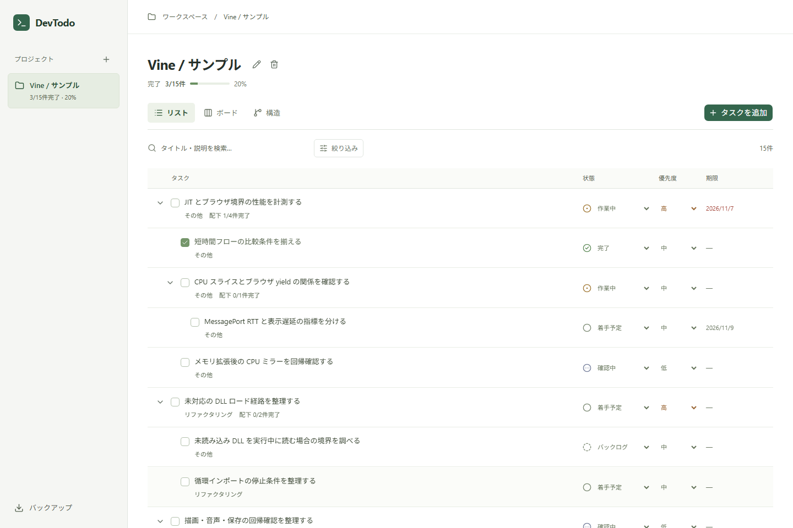
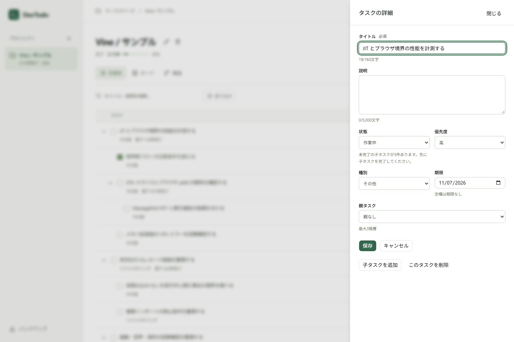
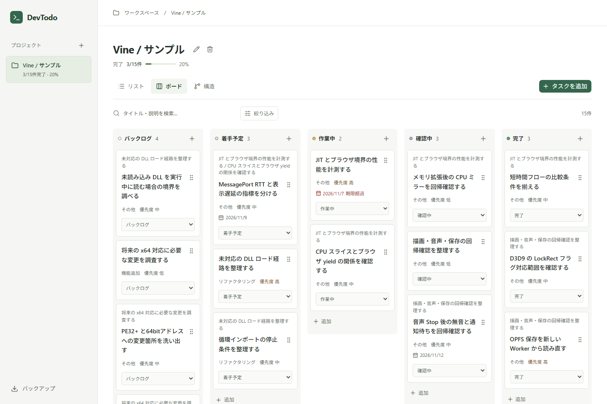
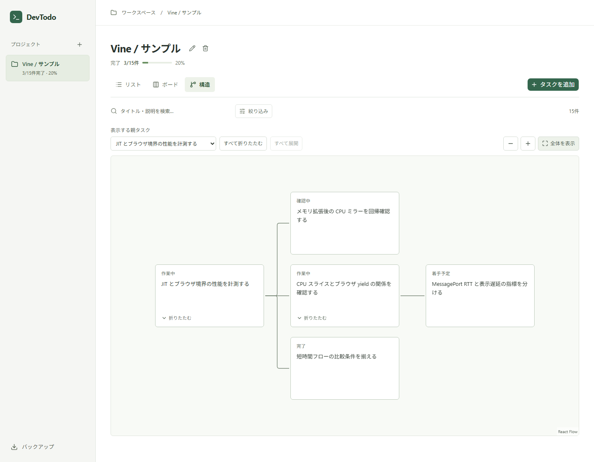
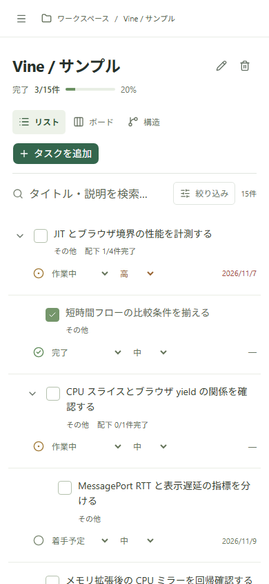
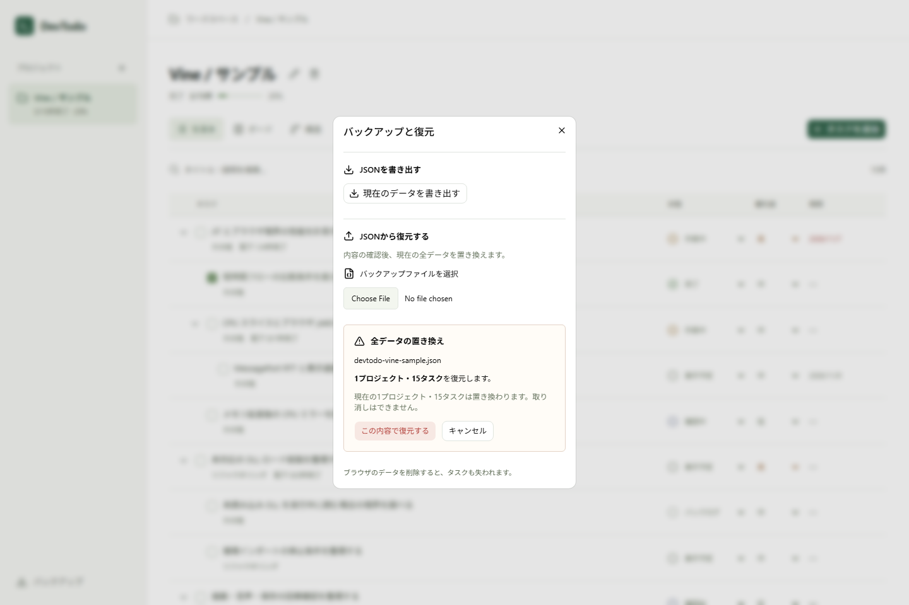

# DevTodo

**[アプリを開く](https://wakka810.github.io/DevTodo/)**

個人開発のタスクを、プロジェクトごとに整理するToDoアプリです。大きな作業を子タスクに分け、進み具合をリスト・ボード・構造図で確認できます。



## 制作背景

ToDoアプリはすでに数多くあるため、最初に既存のアプリを調べ、用途や機能の違いを比較しました。自分で作るなら何に使いたいかを考えた結果、プログラミングなどの開発プロジェクトに使うものにしました。

自分が使う場面を考えると、プロジェクトごとの整理だけでなく、機能追加・不具合修正・調査といった作業の種類、優先度や期限、実装中なのか確認待ちなのかも分けて見たいと思いました。また、大きな機能を細かい作業に分けたときに、一覧を見て次に取り組むことが分かり、それぞれがどの機能の一部なのかも追えると使いやすいと考えました。

こうした用途に合わせ、個人用・ログインなし・複数プロジェクト対応という構成にしました。タスクの追加や編集を手軽に行え、必要に応じて状態・優先度・種別・期限・親子関係を整理できます。機能を増やすこと自体を目的にせず、既存アプリで参考になる点を調べながら、自分に必要なものを選ぶことを意識しました。

### 比較した既存ツール

| ツール | 調べた機能・考え方 |
| --- | --- |
| [Linear](https://linear.app/docs/display-options) | 状態や優先度での整理、リストとボードの切り替え、親子タスクの表示 |
| [Todo Tree](https://marketplace.visualstudio.com/items?itemName=Gruntfuggly.todo-tree) | ソースコード内のTODO・FIXMEコメントを集め、元のコードへ移動する仕組み |
| [Super Productivity](https://super-productivity.com/) | プロジェクトや子タスクの整理に加え、作業時間の計測や集中タイマーも扱う構成 |
| [Taskwarrior](https://taskwarrior.org/docs/filter/) | プロジェクト・タグ・優先度などの条件を使って、必要なタスクを絞り込む考え方 |

比較する中で、開発向けのタスク管理にも、コードから作業を拾うもの、時間を記録するもの、進捗を整理するものなど、異なる使い方があると分かりました。DevTodoでは、個人の開発作業を登録・分類し、進み具合や作業のまとまりを確認する範囲を選びました。コード内コメントの自動収集や時間計測は含めず、手動で登録したタスクを扱う構成です。

## 主な機能

- プロジェクトごとのタスク管理
- 最大3階層の親子タスク
- 状態・優先度・種別・期限の設定
- タイトル・説明の検索と絞り込み
- リスト・ボード・構造図の切り替え
- ブラウザへの保存と、JSONファイルによるバックアップ・復元

## 使い方

例えば、Webアプリに保存機能を追加する場合は、次のように使えます。

1. 「Webアプリ」というプロジェクトを作り、「保存機能を作る」というタスクを追加します。
2. タスク名を押して詳細を開き、「子タスクを追加」から「入力画面を作る」「データを保存する」「再読み込み後に確認する」などに分けます。
3. 優先度や期限を設定し、着手した作業を「作業中」、実装後の動作確認を「確認中」に変更します。
4. ボードで進み具合を確認し、作業の分け方を見直したいときは構造図に切り替えます。

初回画面の「Vineのサンプルを試す」から、15件のサンプルタスクを表示できます。

### タスクの編集

説明や期限、親タスクなどをまとめて編集できます。未完了の子タスクがある場合は、親を完了にできないようにしています。



### ボード

「バックログ」「着手予定」「作業中」「確認中」「完了」の5つの状態で進捗を確認できます。



### 構造図

作業の親子関係を図で確認できます。枝を折りたたんだり、特定の親タスクに絞ったりできます。



### スマートフォン表示

狭い画面では、プロジェクト選択を左上のメニューにまとめています。ボードは選択した状態の1列を表示し、カードのメニューから状態を変更できます。構造図は親子関係を字下げした一覧に切り替え、細かい図を拡大しなくても作業を選べるようにしました。



### バックアップ

データは使用しているブラウザに保存されます。他の端末へ移す場合は、JSONを書き出して復元します。復元すると現在のデータはすべて置き換わります。



## 工夫したところ

### まず登録し、後から詳しく整理できる

新しいタスクはタイトルだけで追加できます。説明や期限などは後から設定できるため、思いついた作業を登録する段階ですべての項目を埋める必要はありません。親子関係は最大3階層まで設定でき、構造図の配置は自動で整えるようにしました。

### 見方を変えても、同じ作業を続けて扱える

リストは状態・優先度・期限を並べて確認し、ボードは状態ごとに作業を見渡し、構造図は大きな作業の分け方を確認するために用意しました。表示ごとにタスクを作り直す必要はなく、どこで編集しても同じ内容に反映されます。検索や絞り込みの条件も表示を切り替えた後に引き継ぎます。

### 検索した後も、どの作業に属するか分かる

子タスクだけが検索に一致した場合も、リストと構造図には親タスクを一緒に表示します。例えば、動作確認のタスクを検索したときに、それがどの機能の確認なのか分かるようにしました。ボードでも各カードに親タスク名を添えています。

### 残っている作業を、親の完了表示で見落とさない

未完了の子タスクがある間は、親タスクを完了にできません。また、完了済みの親の下で子タスクを再び作業中にすると、親も作業中に戻ります。子タスクをすべて完了した場合も、親は自動で完了させず、全体を確認してから手動で完了にするようにしました。

### 編集を確定するタイミングを明確にする

一覧での状態変更はその場で反映し、詳細画面での説明や期限の編集は「保存」でまとめて確定します。編集中に閉じる場合は、保存・破棄・編集に戻る、のいずれかを選べます。保存に失敗しても入力は残し、書き直さずに再試行できるようにしています。親タスクを削除するときは、子タスクも含めた件数を表示し、削除する範囲を確認できるようにしました。

## 使用技術

React / TypeScript / Vite / Tailwind CSS / shadcn/ui

保存にはDexie、ドラッグ操作にはdnd-kit、構造図にはReact FlowとDagreを使っています。入力の検証にはZod、アイコンにはLucideを使用しています。

## ローカルでの起動

Node.js 24とnpmを使用します。

```bash
npm ci
npm run dev
```

開発期間：2026.10.26〜2026.11.09（構想を含む約2週間、約30時間）
